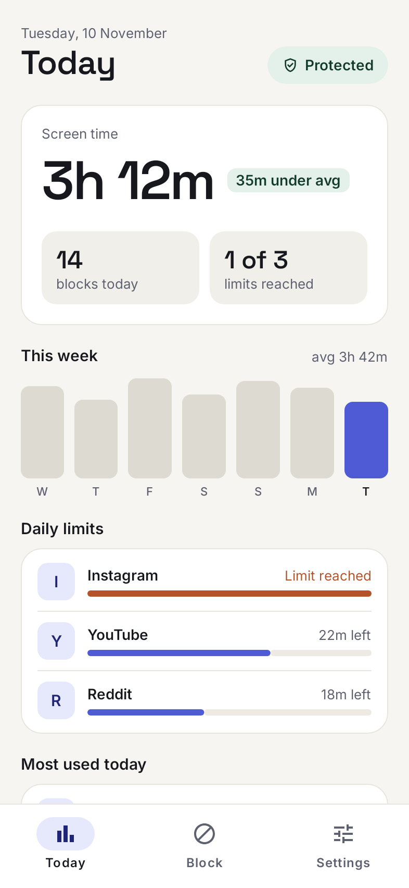
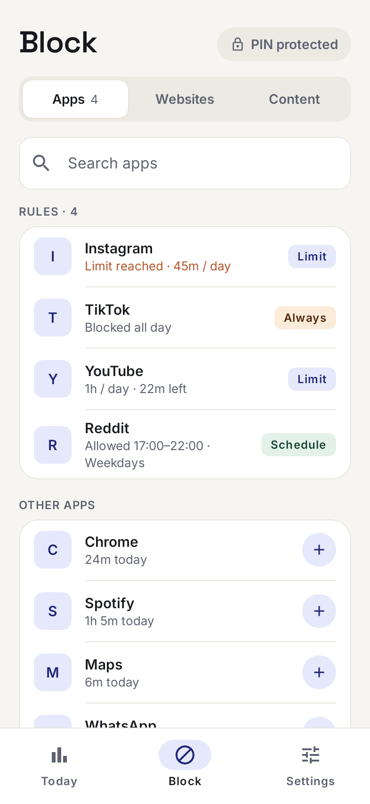

# FocusGuard

[](https://github.com/alexwitting/focusguard/actions/workflows/focusguard.yml)

This was an exercise in building an application with Claude code.

Android app that works as an app, reels and website blocker. 
Block distracting apps, filter websites and short-form content, enforce daily time limits, and track your usage
— all without cloud accounts or subscriptions.

<p align="center">
  
  &nbsp;&nbsp;
  
</p>

<sub>Screenshots are rendered from the real Compose screens with sample data — regenerate them with
`./gradlew :app:testDebugUnitTest --tests "*ReadmeScreenshots*" -PrecordScreenshots`.</sub>

## Features

- **App blocking** — block any installed app on a schedule or always
- **Website filtering** — block domains via a local VPN DNS filter (no root required)
- **Content filtering** — suppress Reels, Shorts, and TikTok FYP feeds
- **Time limits** — enforce a daily usage cap per app; the app locks when the limit is reached
- **Bedtime mode** — automatically block during configurable hours
- **PIN protection** — gate all rule changes behind a 6-digit PIN
- **Usage dashboard** — weekly bar chart and per-app breakdown
- **Fully offline** — no account, no analytics, no cloud sync

## Requirements

- Android 8.0 (API 26) or higher
- Usage Access permission (for time tracking)
- Accessibility Service permission (for app blocking)
- VPN permission (for DNS filtering — optional)

## Building

```bash
# Clone the repo
git clone https://github.com/alexwitting/focusguard.git
cd focusguard

# Debug build
./gradlew assembleDebug

# Install on connected device
./gradlew installDebug

# Run unit tests
./gradlew test

# Lint + static analysis (ktlint, detekt, Android Lint)
./gradlew ktlintCheck detekt lint

# Coverage report → build/reports/kover/html/index.html
./gradlew koverHtmlReport

# Run all checks
./gradlew ktlintCheck detekt lint test
```

No API keys or external services required — the project builds out of the box.

## Architecture

FocusGuard follows Clean Architecture with an MVI presentation layer, split across feature and core modules:

```
:app                  — Hilt root, NavGraph, MainActivity, BlockedActivity
:feature:home         — Usage dashboard
:feature:block        — Block list configuration
:feature:settings     — Time limits, PIN, permissions
:feature:onboarding   — First-run permission grant flow
:core:domain          — Models, repository interfaces, UseCases (pure Kotlin, no Android deps)
:core:data            — Room DB, DataStore, repository implementations
:core:system          — AccessibilityService, VpnService, WorkManager
:core:ui              — Material 3 theme, shared Composables
:core:testing         — Shared fakes for unit tests
:macrobenchmark       — Baseline profile generation + startup benchmark
```

**Tech stack:** Jetpack Compose · Material 3 · Hilt · Room · DataStore · Navigation Compose · Kotlin Coroutines · WorkManager

See [`CLAUDE.md`](CLAUDE.md) for detailed architecture conventions and module dependency rules.

## Contributing

See [CONTRIBUTING.md](CONTRIBUTING.md).

## License

[MIT](LICENSE)
